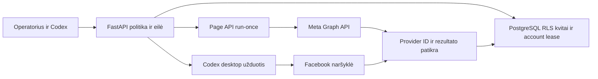

# Bendra Facebook boto sistema

Aktualus prijungimo ir eksploatavimo entrypoint, 2026-10-14. Vykdymo instrukcija: [facebook-bot-setup](../SKILLS/facebook-bot-setup/SKILL.md). Dabartinė source versija perduodama per PR135; main merge ir kitų runtime pritaikymas vertinami atskirai. Senų planų ir testų istorija nepakeičiama nauju PASS.

## Galimybės ir tikras priėmimas

| Veiksmas | Transportas | Įrodymai2026-10-14 |
|---|---|---|
| Valdomo Page tekstas | Oficiali Graph API v26.0 | Tikras POST, patvarus ID, GET autorius/tekstas, matomas Public įrašas |
| Viena Page nuotrauka, komentaras po to Page įrašu, reply į pirminį komentarą | Page API | Įgyvendinta ir izoliuota regresija; šios trys formos šiame gyvame teste atskirai nevykdytos |
| Profilio įrašas su vienu AI vaizdu | Codex desktop Computer Use | Tikras Public įrašas, vaizdas ir permalink |
| Page komentaras grupėje | Computer Use | Pending review→vėlesnis visible comment ID; įrašo autorius atsakė |
| Profilio komentaras | Computer Use | Tikras komentaras po savo nauju bandomuoju įrašu |
| Iki3 grupių metaduomenų paieška | Computer Use | Search→vienos grupės discovery kvitas |
| Signalų / privačių juodraščių rengimas | Acquisition modulis / CLI generatorius | Atskiras senesnis įgyvendintas kelias |
| Like/reaction, join, Messenger/DM siuntimas, collector, nuolatinis FB scheduler | Ši publikavimo eilė jų neturi | Nepriskirti post/comment sėkmei |

Page API įrašams naršyklė publikavimo metu nereikalinga. Reikia veikiančio serverio ir darbuotojo, kuris paimtų užduotį. Profilio ir grupės veiksmams dabartiniame tilte reikia aktyvios Codex desktop naršyklės sesijos. Įprastas CLI `generator=codex` rengia tekstą, o `desktop_worker` tik perduoda serverio užduotį; nė vienas pats naršyklės nespaudžia. Nuolatinio worker,24h proof atnaujinimo, produkcinės Meta prieigos ir hostingo šis rankinis testas neįjungė.

## Architektūra ir bendros ribos



Naudojamas esamas Business/siteId, restricted DB role, `FacebookRecord` ir `FacebookAccountLease`. Naujam verslui nekopijuojamas botas ar scheduler. Runtime pradžia ir užfiksuotos priklausomybės: [README](runtime/README.md). Facebook prijungimas pats neįjungia mail/voice/kitų jobs; esamų migrations istorija nekeičiama.

siteId/environment izoliuoja policies, faktus ir užduotis. Visi to paties tikro Facebook login Page/profilio binding naudoja **tą patį account_key**. Lease koordinacija veikia **vienoje bendroje DB ir tame pačiame environment**. Atskiros lokalios DB ar environments netampa koordinuojamos vien dėl vienodo key. Perduodant tarp PC sustabdyk ankstesnį savo vykdytoją arba naudok priimtą bendrą koordinuojančią runtime DB. Naujas account_key negali apeiti neaiškaus siuntimo užrakto.

## Naujo verslo prijungimas

1. Sėkmingas Git freshness, savo branch/worktree ir exact source SHA; perskaityti aktualius AGENTS, šį entrypoint bei reikiamą transporto runbook. Senas pokalbis, personal skill kopija ar kitos nišos PASS nėra dabartinė prieiga.
2. Nustatyti siteId, runtime environment, konkretų Page/profilį, savininko mandatą, auditoriją, task ir išlaidų ribas, pauzės sąlygą. Verslo tekstui reikalinga patvirtinta dabartinė knowledge projekcija ir tikri kontaktai. `purpose=personal` yra tikram asmeniniam/nekomerciniam testui, ne business-facts blocker apeiti.
3. Privačiai tikrinti operator/worker raktus, runtime DB roles, simulation=false gyvam darbui ir konkretų loopback port. `PINET_CORE_URL` arba CLI `--base-url` turi atitikti tikrą serverį. `STUDIO_NETWORK_SETTINGS` arba `PINET_PUBLIC_CORE_PATH` turi rodyti tikrą contact config. `.env` turinys nerodomas; nenaudojami šio testo privatūs failai kitai nišai.
4. Page API: [Meta programos ir tokenų prijungimas](../SKILLS/facebook-bot-setup/references/meta-page-connection.md). Privatus credential failas→normalus GET verify→tik tada reikalingas įjungimas. Patikrinti programą, PAGE token tipą, tikrą Graph ID/vardą, scopes ir būsimą proof galiojimą. Tokenas expires_at0 nepanaikina core24h patikros TTL.
5. Computer Use: perskaityti actual browser įrankio dokumentaciją, patikrinti tikslų aktyvų Page/profilį UI ir browser actor ID, auditoriją bei formą, užregistruoti riboto galiojimo binding. Browser ID ir Graph ID nustatomi atskirai. Grupėje reikalingos actual taisyklės ir būtent to aktoriaus komentarų prieiga; Join mygtukas savaime neįrodo draudimo.
6. Normalus GET revision→PUT policy su base_revision. Master ir tik reikalingas transportas įjungti, paused=false. Naujos nišos defaultoff; skill diegimas jų neaktyvuoja. Abiem aktyviems transportams nustatyti tą pačią sutartą kvotą. Codex pats peržiūri tekstą, faktus, kalbą, media ir kanalą, įrašo review_note.
7. Proporcingas tikras bandymas→receipt→sutarta pause ir handoff. Dokumentacijos/audito prašymas nesuteikia leidimo naujam viešam testui. Jau autorizuotiems įprastiems post/comment veiksmams nėra kartotinio žmogaus copy approval; naujos Terms/prieigos ir actual tool handoff vertinami savo veiksmu.

## Sąsajos ir svarbūs input

Operator ir worker Bearer raktai atskiri. UI prieiga laikoma atmintyje, ne URL/localStorage. Operator body gauna tik Meta credential_key, ne tokeną. Pagrindinis `/operator/facebook-ui` rodo master, Page verify ir transportų būseną, tikrais kvitais pagrįstą siuntimų skaičių. `/operator/facebook-browser-ui` valdo desktop binding/media/group-access/jobs. API credential GUI šiuo inkrementu nesukurta; API valdomas normaliais HTTP endpoint.

| Bazė | Operacijos |
|---|---|
| `/operator/sites/SITE/facebook` | GET; PUT `/policy`: base_revision, enabled/paused, daily_draft_limit, reason |
| `/operator/sites/SITE/facebook/page-api` | GET; POST `/verify`: credential_key; PUT `/policy`: CAS ir daily_write_limit |
| API `/media`, `/jobs` | POST media key/private path/alt/provenance; job key/credential_key/action/body/review_note/purpose ir parent/media laukai |
| API `/jobs/ID/check`, `/resolve` | Known ID tik GET; atskiras CAS not_published su tikru įrodymu |
| `/internal/sites/SITE/facebook/page-api/run-once` | POST owner, vienas queued darbas |
| `/operator/sites/SITE/facebook/browser` | GET; PUT `/policy` daily_post_limit; POST `/bindings`, `/media`, `/group-access`, `/posts`; `/posts/ID/reconcile` |
| `/internal/sites/SITE/facebook/browser` | `/claim`; `/posts/ID/{renew,check,resume,submit-permit,receipt,discovery-result,block}` |

Tikslūs source kontraktai: [Page API](runtime/src/pinet_core/facebook/page_api_contracts.py), [browser](runtime/src/pinet_core/facebook/browser_contracts.py), [master/group](runtime/src/pinet_core/facebook/contracts.py). HTTP body≤20kB. `photo` turi media_key; API `comment` parent_post_id, `reply` dar parent_comment_id. Owned Page parent tikrinamas ir pagal Graph from.id; reply patikra ribota iki300 pirminių comment ID, paging.next URL nevykdomas. Media vienas nekintamas privatus PNG/JPEG/WebP≤10MiB/20MP; hash tikrinamas before-send, o naršyklėje ir tikra miniatiūra.

Browser binding: key/account_key, actor_kind/id/name, canonical target_url, live/fixture, access/evidence ir valid_until≤30d. Browser post: key/binding_key, body/purpose/audience/review_note, action post/comment/discover_groups; comment exact parent URL ir grupėje group_access_key, post attachment_key, discovery query. Group-access susietas su konkrečiu binding/group hash ir galioja≤1d. Parent/permalink negalima spėti iš login/search URL.

Iš to checkout `runtime/`, naudojant locked uv arba jau paruoštą virtualenv:

```text
python -m pinet_core.facebook.page_api_worker --site SITE --owner OWNER --base-url http://127.0.0.1:PORT
python -m pinet_core.facebook.desktop_worker claim --site SITE --request-file PRIVATE_JSON --base-url http://127.0.0.1:PORT
python -m pinet_core.facebook.desktop_worker renew --site SITE --job JOB --request-file PRIVATE_JSON --base-url http://127.0.0.1:PORT
python -m pinet_core.facebook.desktop_worker submit-permit --site SITE --job JOB --request-file PRIVATE_JSON --base-url http://127.0.0.1:PORT
python -m pinet_core.facebook.desktop_worker receipt --site SITE --job JOB --request-file PRIVATE_JSON --base-url http://127.0.0.1:PORT
```

check/resume/block/discovery-result naudoja tą patį bridge. Claim/resume input `{owner,seconds?}`, check `{owner}`; kitoms komandoms privatus `{owner,task_token,epoch}`. Exact UI/receipt eiga: [desktop reference](../SKILLS/niche-client-acquisition/references/facebook-browser-worker.md). Windows metadata generatoriams naudoti `python -X utf8`; šio skill pirmas cp1252 scaffold FAIL išsaugotas, UTF-8 generatorius pavyko.

## Būsenos, kvotos ir atkūrimas

API: ready→claimed→**sending patvariai prieš POST**→accepted patvarus provider ID→published po GET exact author/body. Accepted nėra galutinės turinio patikros PASS. Timeout/5xx/missingID→uncertain, jokio automatinio POST retry. KnownID check tik GET, galima po pause. Credential hash, facts/contact/instruction snapshot, API revision ir media SHA turi sutapti.

Desktop: ready→claimed→vienas15s permit→vienas actual click→visible/pending_moderation. UI stebėjimas iki20s su tikru UTC, actor/target/body/audience/tab/media. Next yra tarpinis žingsnis; permit išduodamas galutinei Post peržiūrai. Posting/client UUID nėra provider ID. First-comment admin review be ID turi ribotą pending kvitą; visible komentarui vis tiek reikia tikro parent/comment ID ir exact permalink. Vėlesnis read-only kvitas gali pakelti pending į visible po pause.

Claim30–240s, default120s, renew iki120s tik galiojančiam claim. Ilgam paruošimui claim nepradėti per anksti. Expiry/unknown užrakina account; kitas owner/tab/site/key to neapeina. Check-only gali pakeisti prarastą capability, tačiau neatveria naujo composer ir nepublikuoja. Įrodytam not_published naudojamas operator CAS reconcile. Tik jei **niekada nebuvo jokio permit/receipt**, explicit resume gali tęsti tą pačią jau į kvotą įskaičiuotą job su nauju epoch/token ir current context. Po bet kokio permit resume draudžiamas net teigiant, kad nepaskelbta. Pakitęs body/facts/instructions nėra ta pati job.

API ir desktop limitai skaičiuoja abiejų claim bandymus per site/UTC dieną; discovery irgi sunaudoja task vienetą, tačiau nėra send. Abiem limit5 leidžia bendrus5; master daily_draft_limit yra atskira istorinio draft kvota. Tai nėra Meta rate allowance ar globali visų verslų post kvota. Master pause stabdo abi naujas eiles, transporto pause tik savo eilę. Pradėto POST/click pause neatšaukia; vėlyvas tikras receipt išsaugomas. Uncertain lock lieka iki įrodytos read-only reconciliation.

## Diagnostikos sprendimai

| Signalas | Kitas veiksmas |
|---|---|
| CreateProcess rejected/blocked by policy prieš procesą | Host layer, ne core/Meta HTTP klaida. Be rationale priežastis UNKNOWN. Jokio approval override, DB ar kito transporto tam atmetimui apeiti. |
| HTTP401 /503 disabled/paused | Atskiri operator/worker raktai ir actual policies per normalų HTTP |
| Credentials unavailable503 | Path/site/env/key, private file schema, proceso config/perkrovimas; nerodyti.env/tokenų |
| Token identity/scopes403 | PAGE type, app/Graph ID, expiry ir granular scopes. Actual pages_read_user_content, ne gido nesutampantis literalas. |
| Context changed409 | Faktų/kontaktų/instrukcijų/binding/media versijų peržiūra; nauja tikra užduotis, seno hash nekeisti |
| Wrong actor/target | Iki submit sustoti, perjungti tik verified pavedimo aktorių ir stebėti iš naujo |
| Chrome file URL klaida | Įrankio documented permission handoff. Tik po tikro jungiklio pakeitimo tęsti; jis gali atnaujinti browser ID. Internal URL security gate neapeiti CDP/kitais mechanizmais. |
| UI click/helper timeout | Pirmiausia tikras UI rezultatas: click galėjo įvykti. Neaklas retry ar naujas post key. |
| First comment pending review | Registruoti pending, laukti administratoriaus; Join peržiūros nekeičia |
| Expired claim renew409 | Check-only / tikras not_published proof→CAS reconcile; explicit pre-permit resume tik siauru dokumentuotu atveju |
| API accepted/uncertain po nutrūkimo | Išlieka vienas POST; knownID GET, unknown lock/evidence, jokio automatic retry |
| GUI neprijungta/0/undefined po tikro receipt | Tikrinti source/procesą ir status kontraktą; legacy defektas pataisytas pagal verify/policy/receipt, nežinomas audit įvykis turi tekstinį fallback |

## Priėmimas ir perdavimas

Per-site private evidence ir sanitizuotas TOOLS/CORE_FEEDBACK/report: site/env, exact source SHA, proof data ir galiojimas, transportas, scope vardai, aktoriaus patikros metodas, konkretūs job rezultatai, quota/pause, išlaidos, priklausomybės ir rollback. Tokenai/app secret/capabilities/cookies/raw feed/narių/kontaktų sąrašai į Git nekeliauja. Actual provider URL ir screenshot lieka autorizuotam savininkui/runtime.

Atskirk source/isolated regresiją, actual jungtį ir actual veiksmą. Mock/test-* PASS nėra tikras FB post. Pending/uncertain nėra visible PASS. Patikrinti auth, RLS/foreign ID, actor/body/target, pause, epoch, unknown send, idempotency, media mutation, shared kvotą ir late receipts. Pavedimas baigiasi sutartomis užduotimis, kvitais/pause ir savo nepaskelbto composer sutvarkymu. Post/reakcija/parent reply nėra gauta kliento paklausa.

[Gyvas penkių užduočių testas](../docs/FACEBOOK_LIVE_TEST_2026-10-14.md) ir [API/source QA](../docs/FACEBOOK_PAGE_API_CHECK_2026-10-14.md) išlaiko pirmus FAIL. Paveiktų rinkinių galutinė partija125PASS; pakartojimai nesumuojami kaip nauji unikalūs testai. Šis pavyzdys nepriskiria kitos nišos prieigos, audience ar PASS. Main merge, kito PC fetch/skill perskaitymas ir actual adapterio adoption fiksuojami atskirai.

## Atradimas visiems AI

Canonical `SKILLS/facebook-bot-setup/` nurodomas AGENTS, PROJECT_CONTRACT ir acquisition workflow. Katalogas saugo entry SHA ir installed-junction discovery. `node SKILLS/scripts/install-core-skills.mjs` jungia actual project source, išlaiko ir praneša apie esamas nesutampančias kopijas. Personal kopija nėra aktualių instrukcijų autoritetas; nesujungtas source dar nepasiekia kitų PC.

Po reviewed merge kitas AI fetch, perskaito current AGENTS/skill/contracts, įdiegia junction savo profilyje, patikrina realpath/SHA ir atlieka savo actual connection verify. Clone neperduoda Meta tokeno, sesijos ar DB. Naujas skill nekeičia active job snapshot. Privačios prieigos perduodamos tik esamu autorizuotu procesu. Own test preview galima sustabdyti išlaikant volume/credentials/receipts; tai nėra24/7 service.

Detalūs runbook: [Page API](FACEBOOK_PAGE_API.md), [desktop](FACEBOOK_BROWSER_WORKER.md), [historical preparation](FACEBOOK_MODULE.md). Platesnis Messenger/collector planas [FB_ACQUISITION_PLAN](../FB_ACQUISITION_PLAN.md) nepervadinamas į priimtą runtime.
