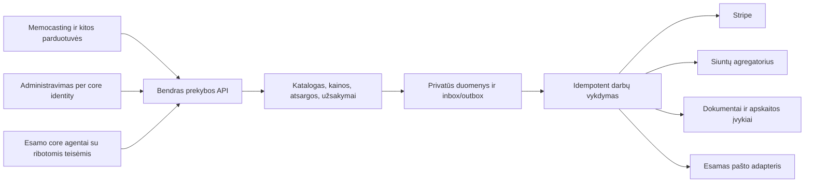

# Bendro prekybos modulio planas

2026-10-11. Šis dokumentas apibrėžia visą numatytą produktą. [Roadmap](ROADMAP.md) nustato darbų seką, [būsena](IMPLEMENTATION_STATUS.md) ir [priėmimas](ACCEPTANCE.md) parodo, kas jau įgyvendinta. Planas nesuteikia suplanuotoms funkcijoms veikiančio statuso.

## Produktas ir panaudojimas

Kuriame vieną prekybos pagrindą kelioms mūsų parduotuvėms. Memocasting — pirmas verslas su dviem rankų liejimo rinkiniais. Nauja parduotuvė turi atskirą katalogą, įmonę, host, rinkas, instrukcijas ir paslaugų paskyras, o užsakymų, kainų, atsargų bei įvykių kodas lieka bendras. Tikras marketplace su kitais nepriklausomais pardavėjais, komisiniais ir išmokomis būtų atskiras M9 sprendimas.

Prekybos domenas yra primary core repo `commerce-core/`. Viešos svetainės rendereris lieka companion repo. SEO/GEO, turinio studija, media, mail, identity ir agentų vykdymas jungiami pagal jų esamas sutartis. Šis modulis nekuria antros studijos, agentų vykdytojo ar kiekvienai svetainei atskiro commerce klono. Registruoti Memocasting į actual runtime tik atskirame tikrinamame integracijos pakeitime.

## Konfigūracija ir duomenų ribos

Parduotuvės konfigūracija: storeId, environment, legalEntityId, priimti hosts, rinkų šalys/valiutos/kalbos, sandėlis, katalogo versija, mokesčių politikos versija, instrukcijų versijos, kontaktai, provider account references ir admission. API paslaptys saugomos atskirai nuo Git ir katalogo. Production negali naudoti testinių įmonių, kainų ar vežėjų.

Lentelės ir privataus objekto raktai izoliuojami storeId. Serveris kontekstą nustato iš priimto host arba patikrintos narystės. Paskyros, įmonės dokumentai, bankas, PDF, pirkėjo adresas ir partnerio kainynas nepersiduoda kitai parduotuvei. Vienas administravimo žmogus gali turėti kelių įmonių teises; tos teisės nesujungia jų pinigų ar dokumentų numeracijos.

Pradinės SQL lentelės: stores, products, inventory, orders, order_lines, event_inbox, outbox, audit, shipments, withdrawals, refunds, journal_entries ir journal_lines. Toliau pridėti versijuotas migracijas: customer/contact/address snapshots, inventory_lots/movements/BOM, shipment_quotes/labels/tracking_events, documents/number_sequences, provider_balance_transactions/payouts/bank_imports/reconciliation_links, companies/price_lists/quotes. Šių ateities lentelių dabartiniame kode nėra.

## Funkcijos ir jų taisyklės

| Sritis | Pilnas rezultatas | Priėmimo kriterijus |
|---|---|---|
| Katalogas | Produktas, fizinis variantas, komplektacija, pakavimo parametrai, instrukcija, viešos medijos projekcija | tikras SKU/versija; faktai atskirti nuo AI redakcinio teksto |
| Rinkų kainos | LT/LV/EE EUR, PL PLN arba patvirtinta kita valiuta; mažmena/didmena; kainos ir taikomo mokesčio snapshot | klientas nekeičia sumos; vartotojui teisinga galutinė kaina; nėra nepatvirtinto 0 % režimo |
| Atsargos | baigtų rinkinių likutis, rezervacija, galiojimas, sandėlio korekcija, partija/galiojimas ir vėliau BOM | atominis visas krepšelis; nulis oversell; taisymas turi priežastį/actor ir operationId |
| Užsakymas | pirkėjo/adreso/pristatymo snapshot, suma, checkout, statusas ir ribota privati prieiga | to paties veiksmo retry duoda tą patį order; istorija neperrašoma katalogo pakeitimu |
| Mokėjimai | Checkout Sessions, dinaminiai paskyros metodai, paid/async/failed/refund/dispute ir suderinimas | SDK signature, account/env/store/order/session/currency/amount; success URL nėra paid |
| Siuntimas | realios paslaugos/paštomatai/tarifas, pakavimo patikra, create/find/cancel, privati etiketė, tracking ir išimtys | patvirtintas LT maršrutas, paketas, adresas ir quote; prarastas atsakymas nesukuria antros siuntos |
| Dokumentai | pardavimo dokumentas, kreditinis, pakavimo lapas, etiketė ir originalių pirkimų saugykla | įmonės/serijos/metų numeracija atominė; originalas nekintamas; korekcija susieta su originalu |
| Grąžinimai | atsisakymo/defekto registracija, dalinės eilutės, siuntos grįžimas, refund ir atsargų patikra | patvarus prašymas; sumų limitas; fizinis grąžinimas ir mokėjimo grąžinimas atskirti |
| Pranešimai | patvirtinimas, apmokėjimas, siuntos statusas ir pagalba per MAIL_CORE | dedup ir faktinė būsena; konkrečios įmonės siuntėjas; tikras gavimo įrodymas |
| Administravimas | užsakymai, pakavimas, etiketės, likučiai, dokumentai, returns, partneriai, išimtys | serverinės rolės ir narystė; realūs persistent duomenys; atskiras browser priėmimas |
| Apskaita | žurnalas, originalai, mokesčiai, fees/FX, payout, bankas, reconciliation, uždarymas/export | balance/source/currency/period kontrolė ir auditas; nesuderinimas negali būti tyliai panaikintas |
| Didmena | partneris, kainynas, MOQ/casepack, pasiūlymas/proforma, sample, reorder ir kredito politika | ne viešas kainynas; tiksli įmonė/šalis; apmokėtas pilotas ir pakartotinis užsakymas |
| Agentų veiksmai | skaitymas, pasiūlymas ir ribotas vykdymas per esamą gateway | scope, sumų ir išlaidų limitai, retry sauga, audit bei eskalavimas |

Memocasting dažų pasirinkimas gali būti atskiras baigtas variantas arba BOM komponentas. Pirmasis kodas turi nepriklausomus baigtų SKU likučius. Negalima vienu metu pardavinėti to paties fizinio rinkinio kaip dviejų nepriklausomų vienetų: prieš realų naudojimą pasirinkti surinkimo modelį ir patvirtinti dažų kiekį/savikainą. Šeimos pilna savikaina taip pat dar nepatvirtinta.

## Mokėjimo, atsargų ir vykdymo eiga

Pirkėjas pasirenka šalį, SKU ir realų pristatymo būdą. Serveris patikrina katalogą, rinką ir tarifą. Užsakymas bei visos rezervacijos įrašomi vienu sandoriu. Stripe sesija kuriama su stabilia idempotency key, serverio kaina ir patvirtintais return URL. Pasirašytas paid įvykis patvirtina apmokėjimą ir įrašo vieną išsiunčiamą įvykį.

Payment, stock, fulfillment ir accounting yra atskiri būsenų pjūviai. Dabartinės būsenos išvardytos API/SQL; planuojamos delivered/disputed/period_closed nėra automatiškai įgyvendintos. Pasibaigus rezervacijai likutis atlaisvinamas. Vėlyvas paid bando jį atomiškai atkurti; jeigu nepavyksta, užsakymas patvariai patenka į išimčių eilę. Jo negalima pažymėti paruoštu be realaus sprendimo.

Pakavimas patvirtina faktinį supakuotą svorį/matmenis ir pristatymo tinkamumą. Kelių rinkinių bendros dėžės matmenys nėra apskaičiuojami tiesiog sudėjus produktų matmenis. Siunta turi stabilią reference. Atsakymo timeout atveju ieškoma ankstesnės registracijos. Jei API neleidžia patikimai ieškoti ar idempotent kurti, neaiškus rezultatas paliekamas rankiniam atkūrimui; automatinis antras mokamas create draudžiamas.

Outbox įrašas sukuriamas kartu su DB pakeitimu. Vykdytojas pasiima lease, pakartotinai bando su tuo pačiu operationId, registruoja rezultatą ir užbaigia įvykį. Po nustatyto bandymų skaičiaus — išimčių eilė/DLQ. El. laiškas, dokumentas ir siunta turi savo dedup kontrolę. Dabartinis paketas turi lease/ack pagrindą, o consumer ir DLQ dar neprijungti.

## Logistika keturioms rinkoms

Pirmiausia rinktis agregatorių su apmokėjimu už faktinę siuntą, jei jo API sąlygos tai leidžia. Reikalavimas „be ilgalaikės vežėjo sutarties“ nereiškia „be paskyros, mokėjimo ar API aktyvavimo“. Kandidatai ir šaltiniai — [Memocasting TOOLS](../../sites/memocasting/TOOLS.md); tarifų ir minimumų dar nepatvirtinome.

Kiekvieną LT→LT/PL/LV/EE paslaugą tikrinti atskirai: 2 kg 20×20×17 cm ir 4 kg 25×25×20 cm, pašto kodas, paštomato limitai, surinkimas/pridavimas, grąžinimo kaina, draudimas, papildomi mokesčiai, etiketės formatas ir įvykio duomenų atnaujinimas. Mokestis checkout turi sutapti su priimta quote/politika. Paštomatas turi priklausyti pasirinktai šaliai ir paslaugai. Viešas pažadas apie terminą galimas tik pagal tikrą veikimo modelį.

Etiketės/banko dokumentai privatūs R2 ar lygiavertėje priimtoje saugykloje. Prieiga per serverio teises arba trumpą pasirašytą nuorodą. Užsakymo tracking puslapis rodo pirkėjui reikalingą statusą, o ne visą vežėjo payload. Fizinis paėmimas/pridavimas lieka tikru sandėlio veiksmu, nors registravimas gali būti automatinis.

## Apskaita ir agentai

AI agentai klasifikuoja originalius dokumentus, siūlo įrašus, paaiškina nesuderinimą ir ruošia ataskaitas. Patvirtintos rutininių įrašų taisyklės gali būti vykdomos automatiškai. Balansas, dokumento unikalumas, laikotarpis, suma, valiuta ir mokesčių režimas tikrinami kodu. Vadovo vidaus kontrolės atsakomybės pagrindas — [AVNT paaiškinimai](https://avnt.lrv.lt/lt/duk/). Detalesnis ankstesnis tyrimas yra vietiniame outputs/memocasting-tyrimas-20261011/PLANAS.md, jis nėra Git priklausomybė.

Sale, Stripe fee, FX ir payout registruojami atskirai. Payout nėra antras pardavimas. Viena išmoka gali dengti daug užsakymų ir refunds iš kito laikotarpio. Banko importas turi hash/provider reference dedup; nesuderintos sumos patenka į išimtį. Ne PVM mokėtojos būsena savaime nepatvirtina visų tarpvalstybinių režimų. Tax policy ir dokumentų formatai tikrinami prieš aktyvuojant šalį.

Agentas tiesiogiai nerašo SQL, nekeičia order sumos ir neperrašo journal istorijos. Atskiros teisės: read, propose, post, refund, shipment spending, outreach ir filing. Piniginiam veiksmui būtinas serverio limitas, faktinis pagrindas, operationId ir kvitas. Naujas režimas, neaiškus dokumentas, nepasiekiamas tiekėjas arba konfliktas keliauja eskalavimui. Refund vykdymas ir deklaracijos pateikimas negali būti pažymėti įvykdytais iš AI teksto.

Aptarnavimo agentas kuriamas po svetainės su priimtomis instrukcijomis ir tikros parduotuvės užsakymų read sąsaja. Partnerių agentas: public paieška → kandidato patikra → CRM → pasiūlymas → teisėtai ir konkrečiai autorizuotas kontaktavimas → realus atsakymas → pilotas/reorder. Partnerio susidomėjimas niekada nesukuriamas iš vien atrasto URL. Abu agentai naudoja esamą calibration skill, protected unseen bandymus, knowledge ir channel priėmimą.

## Didmenos plėtra

Company profilis turi teisės statusą, šalį, adresus, mokėjimo ir dokumentų režimą; VAT numeris tikrinamas pagal taikomą režimą, o ne iš logotipo. Price list nustato SKU, valiutą, kiekių pakopas, MOQ, casepack, galiojimą ir pristatymo sąlygas. Quote fiksuoja kainų/instrukcijų/rekvizitų versijas; priimtas quote virsta įprastu commerce order. Pakartotinis užsakymas pernaudojamas per tą patį kelią.

Pirmas pilotas: viena šalis ir partneris, tikri pavyzdžiai, vietinės etiketės/instrukcijos, apmokėjimas iš anksto, realus maržos ir siuntos bandymas. Kreditą/split settlements įjungti tik pagal patvirtintą politiką. EN wholesale pateikimas ir ES/PL partnerių medžiaga numatyti turinio plane; šių rinkų puslapiai neįrodo veikiančių partnerių.

## Svetainė, SEO/GEO ir migracija

[Pilnas Memocasting temų planas](../../sites/memocasting/SEO_GEO_PLANAS.md) apima pirkimą, palyginimą, naudojimą, klaidų pagalbą, dovanojimą, priežiūrą ir didmeną LT/PL/LV/EE, su EN/ES B2B plėtra. Topical authority pirmiausia kuriama apie tikrus rankų liejimo rinkinius ir su jais susijusias dovanas. Visų pasaulio dovanų kategorijų aprėptis nėra dviejų produktų parduotuvės priėmimo tikslas.

Po modulio: tikros savininko nuotraukos per MEDIA_CORE, individualus dizainas pagal core typography/kalbos taisykles, veikiančios produkto CTA, schema iš realios kainos/likučio, hreflang/canonical/sitemap pagal rendererį ir privatiems keliams noindex. Instrukcija bei saugos teiginiai grindžiami tiekėjo dokumentais ir mūsų produkto bandymu. Nuotraukų trūkumas nestabdo bendro modulio, tačiau AI vaizdas nepakeičia tikro produkto ar kliento rezultato.

Shopify istorija: išsaugoti eksportus, URL ir GSC duomenis; kiekvienam puslapiui retain/rewrite/merge→301/remove su prasmingu tikslu. Domeno/DNS/pašto perkėlimas ir Shopify abonemento nutraukimas tik po duomenų bei naujo pirkimo kelio patikros. Pilnas senų URL sąrašas dar negautas. Netvirtinti, kad būsimi puslapiai jau indeksuoti ar reitinguos.

## Išleidimo vartai ir kaštai

Prieš pirmą realų checkout: pasirinkti MB paskyrą ir mokesčių taisyklę, patvirtinti katalogą/kainą/BOM/likutį, instrukcijas ir operatoriaus kontaktą, adresą, vežėjo paslaugas, refund politiką, numeraciją, identity, laiško siuntėją ir duomenų atkūrimą. Atlikti vieną tikrą mažą payment → document → pack → label → shipment → bank reconcile ir refund bandymą. Kiekvienai naujai šaliai atlikti jos operacinį priėmimą.

Infra, Stripe/FX, vežėjas/pakuotė, paštas, AI/OCR/paieška, vertimai, dokumentų parengimas, fizinis darbas ir grąžinimai yra atskiros sąnaudos. Shopify abonemento atsisakymas jų nepanaikina. Pradžioje nekurti jokio blanket „viskas kainuos 5 USD“ pažado. Budget/usage limits nustatyti per account ir veiksmą, maržą matuoti per faktiškai įvykdytą SKU/šalį bei partnerio reorder.

Atšaukimas: iki activation scoped PR revert nesiliečia su esamomis parduotuvėmis. Po duomenų atsiradimo migracijos yra forward-compatible ir turi backup/restore bandymą; rollback negali reikšti order ar finansinės istorijos ištrynimo. Provider įvykiai, queue ir DB versijos sutikrinami prieš release. Source merge, kito PC adoption ir production yra trys atskiri priėmimai.
