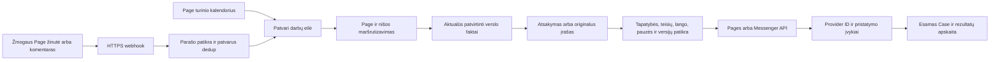

# Facebook core plano ir realizacijos auditas

2026-10-14, Europe/Kiev. Savininko pavedimas: nuodugniai patikrinti planą, veikimo eigą ir API / computer-use poreikį. Darbo rezervacija: [issue133](https://github.com/christianza1989/nisiniai-puslapiai-monetizavimui/issues/133).

## Sprendimas

Architektūros kryptis tinkama: vienas kanalų koordinatorius, bendras verslų registras ir atskiras kiekvienos nišos kontekstas. Tačiau dabartinis kodas yra privatus signalų ir juodraščių paruošimas. Jis dar nėra savarankiškai veikiantis Facebook kanalas.

Pagrindinį botą siūlau statyti ant **valdomos verslo Page API**: originalūs Page įrašai, atsakymai į Page komentarus ir Page Messenger. Šioms operacijoms nuolatinio naršyklės valdymo nereikia. Reikia nuolat pasiekiamo HTTPS serverio, duomenų bazės ir užduočių vykdytojo. Naršyklė reikalinga pradinei konfigūracijai bei toms atskirai leidžiamoms operacijoms, kurioms nėra priimto API.

Grupių paieška ir veikimas asmeniniu profiliu turi savo priklausomybes. Senasis Groups API pašalintas; Page API nepakeičia grupių API. Trečiųjų šalių skaitymo paslauga gali techniškai sumažinti computer-use poreikį, bet savaime nepatvirtina duomenų naudojimo teisės ir nesuteikia komentarų ar asmeninių DM siuntimo.

**Vietinio paruošimo patikra: PASS su šiame darbe pataisytais defektais. Gyvo kanalo parengtis: FAIL; konkrečios Page / app / token prieigos: UNVERIFIED.** Tai trys atskiri vertinimai.

## Tikslūs peržiūrėti šaltiniai

- Audito šaka `codex/facebook-full-audit-20261014` sukurta iš sėkmingai fetched main `7af6b9641012a30c5f95eac38a66daeff8f8cb39`.
- Pradinio katalogo HEAD `df3c055afbfa99260970b61e38fce7ed95d617f2` yra 234 commit priekyje. FB modulio source / pagrindiniai FB dokumentai nesiskyrė nuo fetched main; kitų modulių neperėmiau.
- Main: [FB_ACQUISITION_PLAN](../FB_ACQUISITION_PLAN.md), [FACEBOOK_MODULE](../agent-business-core/FACEBOOK_MODULE.md), visas `runtime/src/pinet_core/facebook/` paketas, migracija0009, testai, acquisition skill ir jo FB priedas, istorinis QA.
- Papildomas v2 planas: [PR20](https://github.com/christianza1989/nisiniai-puslapiai-monetizavimui/pull/20), OPEN, head `da5493c16c38a5840c73661dc3fed3f181bcf49a`. Perskaityti [FB_AGENT_ROADMAP](https://github.com/christianza1989/nisiniai-puslapiai-monetizavimui/blob/da5493c16c38a5840c73661dc3fed3f181bcf49a/FB_AGENT_ROADMAP.md), jo RESEARCH ir PROFIT_ENGINE. Šių dokumentų main nėra. Jų peržiūra nėra merge ar runtime priėmimas.
- PhoneBridger produkto ir kainų tyrimas2026-10-07 naudotas tik piloto plano kontekstui. Šis auditas nepatvirtino dabartinio produkto release, kainų, mokėjimo ar FB Page nuosavybės.
- Dabartiniai Meta dokumentai perskaityti Chrome2026-10-14. Web skaitymas grąžino429/login; pirmas in-app browser bandymas nepavyko. Sėkmingas įrodymas yra tiesioginis oficialių puslapių tekstas Chrome, o ne paieškos ištrauka.

## Kanalų matrica: API ar naršyklė

| Operacija | Tinkamas techninis būdas | Computer use veikimo metu | Dabartinis mūsų adapteris |
| --- | --- | --- | --- |
| Publikuoti savo Page tekstą / nuorodą | Pages API, Page token ir konkrečios publikavimo teisės | Nereikia | Neįgyvendintas |
| Savo Page nuotraukos / vaizdo įrašai | Atskirai priimtas formato upload/publish API | Nereikia | Neįgyvendintas; ne visi media formatai priimti |
| Atsakyti į savo Page komentarą | Pages komentarų API, tikslus post/comment ID ir Page aktorius | Nereikia | Neįgyvendintas |
| Page Messenger inbound / atsakymas | Messenger webhook ir Send API, Page+PSID, realus siuntimo langas | Nereikia | Tik izoliuotas sintetinis fixture, tikro webhook nėra |
| Skaityti kitų viešų grupių įrašus | Patikrintas leistinas duomenų šaltinis; galima vertinti trečiosios šalies skaitymo API | Sąlyginai galima apsieiti be naršyklės | Collector ir tiekėjo adapterio nėra |
| Stoti / publikuoti / komentuoti kitų grupėse kaip profilis ar Page | Tik konkrečiai patvirtintas grupės ir platformos transportas; seno Groups API nėra | Jei priimamas UI adapteris, reikalinga veiksmui; vienas vykdytojas | Neįgyvendintas ir nepriimtas |
| Asmeninis Messenger | Atskirai patvirtintas asmeninio kanalo transportas | UI atveju reikalinga veiksmui | Page API nesuteikia šios prieigos; neįgyvendintas |

Meta [Groups changelog](https://developers.facebook.com/docs/graph-api/changelog/version19.0/) patvirtina Groups API, susijusių leidimų ir apps diegimo grupėse pašalinimą2024-04-22. Peržiūrėtuose oficialiuose dokumentuose nerasta bendro pakaitalo savavališkai skaityti ir komentuoti visas grupes. Tai ne draudimas visoms kitoms Meta API.

[Pages posts](https://developers.facebook.com/documentation/pages-api/posts) aprašo nuosavos Page publikavimą, nuotraukas ir planuojamus įrašus. [Comments and mentions](https://developers.facebook.com/documentation/pages-api/comments-mentions) aprašo komentarus kaip Page; naudotojo profilis ir grupės iš to negauna publikavimo teisės. Tikrinti aktualius scopes ir Page tasks realioje programoje; @mention, moderavimas ir atsakymas turi skirtingas paskirtis.

Treg kataloge2026-10-14 rasti `anyapi.facebook.group.posts` ir `scrapecreators.x.v1-facebook-group-posts`. Katalogo deklaruojamos kainos:0,002 ir0,00188USD už kvietimą; tai ne mūsų actual sąnaudos ar darbo kokybės bandymas. Kataloge jie aprašyti kaip viešų grupių skaitymas, ne oficialus Meta Groups API ar siuntimas. Provider kvietimų neatlikta; mokamų calls0. Katalogo `platform_eligible` ir patikimumo statistika nėra Meta leidimo įrodymas. Prieš pasirinkimą reikia patikrinti tiekėjo sutartį, kilmę, konkretų duomenų naudojimą ir faktinę aprėptį; privati grupė nesulyginama su vieša.

[Automated Data Collection Terms](https://www.facebook.com/legal/automated_data_collection_terms), effective2024-10-07, atskiria Meta rašytinį leidimą nuo vien sąlygų priėmimo. Automatinis rinkimas apima ir programinę naršyklę. Todėl browser ar tarpinis API nėra savaiminis teisių sprendimas; collector lieka OFF, kol konkretus pagrindas nepatvirtintas.

## Kaip veiks pagrindinis Page kanalas

1. Tikras valdomas Page susiejamas su konkrečiu `business_id/siteId`. Viena bendra Page galima, tačiau neaiški niša lieka nepriskirta; kitos nišos tekstai nepateikiami modeliui. Originaliam Page postui reikia atskiro turinio darbo, nereikia išgalvoto pirkėjo signalo.
2. Viešas HTTPS webhook tikrina challenge ir POST kilmės parašą, riboja body, atskiria event rūšis, saugo gautą įvykį ir deduplikavimo raktą. Tik po patvaraus priėmimo patvirtina gavimą. Inbound, delivery, read, echo, reaction ir redagavimas nėra vienoda kliento užklausa.
3. Page žinutėms tvarka saugoma pagal Page+PSID ir konkretų pokalbį. Modelio užduotis gauna tik leidžiamą aktualų kontekstą. Nauja kliento žinutė, pauzė, žmogaus perėmimas ar pakeisti faktai atšaukia nebeaktualų atsakymą.
4. Siuntimas vyksta per serverinį transportą. Prieš pat siuntimą pakartotinai tikrinamas langas, atsisakymas, aktorius, naujausia žinutė, faktų ir policy versijos. Tokenai modelio prompte ar naršyklės vietinėje saugykloje nelaikomi.
5. Gavus provider ID registruojamas rezultatas; delivery/read įvykiai atnaujina atskiras būsenas. Tikras projekto poreikis susiejamas su esamu CaseSource. Įrašų sklaida, click, supplier ir sintetinis testas nevadinami gautu klientu.

### Dvi skirtingos delsos

[Webhook dokumentas](https://developers.facebook.com/documentation/business-messaging/messenger-platform/webhooks) nurodo HTTP200 atsakymą per ne daugiau kaip5s, deduplikavimą, pranešimų timestamp ir parašo tikrinimą. GET verify token nėra POST kilmės parašo pakaitalas. Patikroje reikia tikro raw body, įskaitant Unicode, ir privalomo parašo atmetimo mūsų realizacijoje; dokumentacijos pavyzdžio warning nepakanka.

[Messenger policy](https://developers.facebook.com/documentation/business-messaging/messenger-platform/policy) nustato30s vartotojui matomo atsako reikalavimą jos apibrėžtiems automatiniams botams; Get Started išimtis aprašyta atskirai. HTTP200 Meta serveriui nėra atsakymas žmogui. Esamas Codex worker gali atlikti du kvietimus po100s, todėl jo negalima laikyti vieninteliu sinchroniniu pokalbio atsaku. Reikia greito teisingo atsako arba aiškaus saugaus patvirtinimo žmogui, po kurio ilgiau trunkantis darbas vyksta asinchroniškai, su vėlesnio atsakymo versijos ir lango patikra. Tikslaus SLA dar neišmatavome.

[Messenger overview](https://developers.facebook.com/documentation/business-messaging/messenger-platform/overview) aprašo Page-scoped ID, dažniausiai24h langą ir sąlyginį iki7d pirmos žinutės po atitinkamos reklamos atvejį. HUMAN_AGENT negalima laikyti universaliu AI tęsinio leidimu. Private reply į Page komentarą turi atskirą ribą ir nėra grupės žmogaus šaltų DM kanalas.

### Prieiga ir talpinimas

Overview pateikia own-Page App Review išlygą; webhook dokumentas klientams be app rolės aprašo Advanced Access ir App Review. Šios bendros formuluotės neįrodo mūsų būsimos programos prieigos. Prieš production reikia patikrinti realų app mode, Page tasks, token scopes, access level ir bandymą su žmogumi be app rolės. Admin self-test priima tik self-test.

API botui neprivalo būti įjungtas savininko PC ar atidarytas Codex pokalbis, jeigu serveris ir worker jau veikia kitame priimtame host. Dabartinis CLI adapteris ieško Windows APPDATA/npm kelio, todėl vien Git clone į Linux ar serverless hostingą neįrodo jo veikimo. Reikia konkrečiai priimto worker host, modelio autentifikacijos ir atkūrimo. Vietinis PC miega → vietinis worker sustoja. 24/7 prieigos šiame audite neįjungta.

Grupių UI adapteriui, jeigu jis apskritai priimamas, reikia atskiros išlikusios sesijos ir browser/computer-use vykdytojo. Jis įsijungia darbui, o ne privalo be pertraukos laikyti modelį stebintį ekraną. Viena paskyros lease, renewal/release, epoch patikra ir žmogaus darbo sustabdymas būtini. Page API srautas nelaukia šio browser užrakto.

## Pilna patikros matrica

PASS reiškia patikrintą nurodytą apimtį. FAIL gyvo paleidimo eilutėje reiškia trūkstamą realizaciją, nebūtinai defektą jau priimtame vietiniame modulyje. UNVERIFIED reiškia, kad nėra konkretaus aktualaus įrodymo.

| ID | Sritis | Būsena ir įrodymas / trūkumas |
| --- | --- | --- |
| A01 | Vienas koordinatorius ir site kontekstas | PASS plano kryptis; atskiro CRM nereikia |
| A02 | Pilno v2 plano pristatymas į main | FAIL: PR20 OPEN, v2 roadmapas nėra main |
| A03 | Default OFF, site pause, policy revizija | PASS: source ir esami DB testai |
| A04 | Tenant izoliacija, RLS, case FK | PASS: iš naujo paleisti FB testai ir disposable0009 schema |
| A05 | Signalas atskirai nuo tikros paklausos | PASS: source, fixture ir overview testai |
| A06 | Užduoties replay po signalo senėjimo | FAIL baseline409; FIXED LOCAL, naujas ir legacy hash replay bei changed-command409 |
| A07 | Companion config izoliuotame worktree | FAIL baselineFileNotFoundError; FIXED LOCAL, explicit config / public root / sibling precedence |
| A08 | Browser account lease/fencing pagrindas | PASS lokali DB primitive; nėra actual browser writer priėmimo |
| A09 | Browser lease renew/release ir žmogaus perėmimas | FAIL live: realizacija / konfliktų bandymai nepateikti |
| A10 | Grupių registry ir naudojimo evidence | PASS privati metaduomenų saugykla; UNVERIFIED realios rules/membership/Meta teisės |
| A11 | Automatinis discovery/collector | FAIL live: nėra nei official, nei third-party adapterio, cursor ar watermark |
| A12 | Savo Page originalus turinys ir scheduling | FAIL live: numatyta PR20, dabartiniai action kinds tik signalų drafts |
| A13 | Page įrašų ir komentarų transportas | FAIL live: nėra publishing/upload/reply adapterio ir actual kvito |
| A14 | Messenger POST/GET webhook | FAIL live: fixture nėra challenge/signature/live ingestion |
| A15 | Page/app/token/current access | UNVERIFIED: paskyros prieigos ir naujų grants netikrintos |
| A16 | Webhook5s ir žmogaus atsakymo30s | FAIL live: nėra matavimo ar greito pokalbio adapterio |
| A17 | Window, opt-out, žmogaus perėmimas | FAIL live: nėra realių Page pokalbių politikos vykdymo |
| A18 | Send outbox ir uncertain sutikrinimas | FAIL live: `/send` sąmoningai grąžina503; modelio expired nėra external reconciliation |
| A19 | Du PC, crash/restart, global pause | FAIL live: DB lease testas nepriima nuolatinės hosted grandinės |
| A20 | Modelio instrukcijos ir pasenę faktai | PASS vietinės hash/revision patikros; held-out kalibracija visiems naujiems kanalams UNVERIFIED |
| A21 | Žmonių tekstai ir modelio prieiga | PASS permitted inputs model claim blokuoja; anonymous yra operatoriaus deklaracija, ne anonimizatorius |
| A22 | Kvotos ir išlaidos | PASS site draft/attempt dienos kvota; FAIL live global account/AI/media spend ledger ir nesėkmių kainų completeness |
| A23 | Duomenų retention / deletion | FAIL live: nėra FB-specific cleanup; Case retention jo nepakeičia |
| A24 | Komercinė atribucija ir pelnas | FAIL live: nėra tikrų FB outcome/order/cost adapterių; plano ekonomika tik hipotezė |
| A25 | GUI duomenų izoliacija | PASS source ir istorinis390px QA; nauja browser UI sesija šiame audite nevykdyta |
| A26 | Hosted naudotojo auth / grants | UNVERIFIED: FB routes naudoja legacy operator secret; iš šio main neįrodyta current actor portal integration |
| A27 | Saugios sistemų ribos | PASS: nėra browser/Meta send tool draft generatoriuje; naujų live veiksmų0 |
| A28 | PhoneBridger pilotas | UNVERIFIED actual Business/projection/Page/live outcome; jo kontaktų išimties neperrašyti default |

## Kas plane dar turi būti konkretinama

1. **Pirmas vertikalus etapas turi būti Page.** Priimti vieną tekstinio/nuotraukos posto formatą ir vieną inbound Page pokalbį. API apribota grupių šaka nestabdo šio darbo. Savo Page turinio poreikis ir konkrečiam žmogui skirtas reply yra skirtingos eilės.
2. **Delsos ir prieigos vartai turi atskirus testus.** Nurodyti5s durable ACK,30s žmogaus atsakymą, app-role ir non-role bandymus, expired window, revoked token ir netikro parašo atmetimą. Operator enabled switch šių testų nepakeičia.
3. **Local idempotency nėra provider exactly-once garantija.** Po galimo external submit timeout negalima vėl siųsti vien pakeitus mūsų raktą. Reikia tikro provider ID / echo / kitokio patvirtinto read-only sutikrinimo; neįrodomas rezultatas lieka uncertain. Šiame audite provider idempotency galimybės netestuotos.
4. **Retention nėra vien trys savavališki terminai.** PR20 numatytos7/30/90d ribos yra hipotezė. Automatizuoto rinkimo sąlygose numatyti compliance records mažiausiai vienerius metus po tų sąlygų pabaigos; tai nereiškia metų visiems postams ar klientų tekstams. Atskirti minimalų compliance evidence nuo duomenų, kurių nebereikia, ir priimti tik konkrečiam naudojamam kanalui taikomą ištrynimo sutartį.
5. **Būtinas nuolatinio vykdytojo priėmimas.** Worker gyvenimo ciklas, mokamas modelio/host biudžetas, fresh faktų atnaujinimas, queue fairness ir backlog turi būti išmatuoti. Du CLI kvietimai ir20 draft/d. nėra paslaugos pajėgumo ar sąnaudų prognozė.
6. **Plano pristatymas ir vykdymas turi būti matomi atskirai.** PR20 nereikia tyliai kopijuoti ar laikyti merged. Pirmam įgyvendinimui suderinti jo planą su šiuo auditu; būsimos migracijos kuria naujas revisions, istorinė0009 nekeista.

## Atliktos pataisos ir regresija

`facebook/service.py` dabar skaito `STUDIO_NETWORK_SETTINGS`, po to `PINET_PUBLIC_CORE_PATH/config/niche-network.json`, o jų nesant išlaiko seną sibling kelią. Aiškiai nurodytas netinkamas failas nesukelia tylaus perėjimo į kitos konfigūracijos kontaktus. Patikrinti site contact override ir instruction/facts snapshot.

Action idempotency dabar lygina pateiktą komandą (`key`, `signal_id`, `kind`), o ne nuo laiko priklausančią qualification projekciją. Legacy įrašų pradiniai hash ir payload neperrašomi. Pakartojimas grąžina tą patį įrašą; pakeista komanda gauna409. Qualification replay išlieka originalus snapshot; ruošimo metu ji apskaičiuojama iš naujo. Tai nesuteikia send leidimo.

- Prieš config pataisą: naujas izoliuoto worktree testas1FAIL su FileNotFoundError.
- Prieš replay pataisą:16 esamų FB testų PASS; papildomas signalo senėjimo testas1FAIL su409.
- Po pataisų ir galutinio fixture organizavimo:21 testas PASS (16 esamų FB,2 naujo / legacy replay,3 workspace),10,38s. Papildoma core/policy/CodexLab regresija32/32 PASS,34,41s; iš viso53 aktualūs testai. Scoped Ruff PASS.
- Tikras disposable0001–0009 schema check:20 lentelių,16 FORCE RLS, patikros UUID schema pašalinta. Tikrinimo DB buvo nuosavas container `pinet-facebook-audit-20261014`, loopback15446, vien sintetinis testų turinys. Patikrinus tikslų savo vardą ir scope label, po bandymų jis sustabdytas ir pašalintas kartu su savo testiniu volume. Kitų runtime DB ar procesų neprijungiau.
- LLM actual generation, naujo GUI desktop/mobile, live Page/webhook/send, provider scraping, App Review ir production hosting bandymai NOT RUN. Istorinis CLI/GUI PASS nepaverstas nauju.
- Audito metu testų paruošimas pirmąkart nepavyko dėl audito autoriaus neteisingo savo `.env` katalogo, pataisyta tik savo scratch vieta. Tai atskirta nuo dviejų product regresijų. Pradinis managed-worktree kūrimo app bandymas taip pat nepavyko dėl tracking; naudojamas atskiras Git worktree iš fetched main.

Šaltinio pataisa perduodama scoped PR; reviewed main merge, kitų PC fetch ir konkretaus veikiančio adapterio adoption lieka atskiri. Main neturi `core-upgrade-check.mjs`; coverage patikrai naudojamas papildomai užfiksuotas esamo core checkout helperis su `--root` į šią audito šaką, ne kopijuojamas ar pateikiamas kaip main dalis.

## Įgyvendinimo eilė po audito

1. Suderintas v2 planas ir vienas actual Page/business/contact/projection manifest.
2. Vietinė Page turinio, webhook, greito atsako, lango, perėmimo ir outbox grandinė su fixtures.
3. Vienas actual app/Page self-test: publication ID, tikras inbound, viena reply ir non-role access vartas.
4. Nuolat pasiekiamas host, recovery, deletion, kvotos / kainų apskaita ir operatoriaus pauzė.
5. Ribotas verslo pilotas su tikromis užklausomis / pirkimu; grupių collector ar UI adapteris vertinami atskirai pagal realias teises ir ekonominę naudą.

Tai įgyvendinimo rekomendacija; dabartinis pavedimas yra auditas ir atkuriamų klaidų pataisos, ne gyvo kanalo įjungimas.
