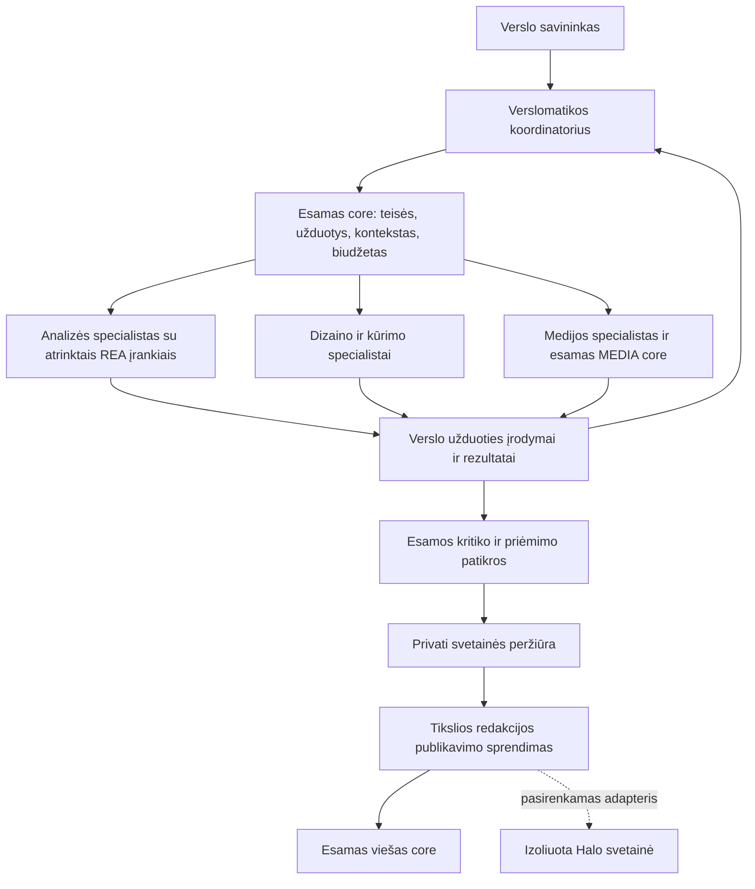

# OpenJarvis REA ir Halo pritaikymas Verslomatikai

2026 m. spalio 15 d. sprendimo pasiūlymas. Tikslas — sutrumpinti veikiančios Verslomatikos kūrimą, išlaikant esamą bendrą core, verslo duomenis ir jau sukurtą darbo erdvę.

Didžiausią naudą duotų trys skirtingi pritaikymai: **REA kaip svetainių analizės ir patikrų įrankis; Halo kaip pasirenkamas turinio valdymo ir publikavimo adapteris; OpenJarvis kaip konkrečių agentų, įrankių ir diagnostikos sprendimų šaltinis.** Visų trijų sistemų paleidimas vienos vietoje kitos neprijungtų likusių mūsų platformos dalių ir sukurtų papildomą būsenų sinchronizavimo darbą.

## Sprendimų palyginimas

| Projektas | Reali paskirtis | Nauda Verslomatikai | Siūlomas sprendimas |
| --- | --- | --- | --- |
| OpenJarvis | Vietinių ir debesijos modelių vykdymas, agentai, įrankiai, atmintis, darbo eigos, matavimas ir mokymasis | Aiškūs agentų ir įrankių aprašai, užduočių priklausomybės, konteksto atranka, vykdymo analizė | Perimti atrinktas idėjas ar izoliuotus modulius; dabartinės vykdyklės ir kalibravimo sistemos nekeisti |
| REA | Programų, svetainių, skriptų ir vykdymo įrodymų analizė per CLI / MCP | Geresnė svetainės pavyzdžio analizė, užfiksuotų klaidų diagnostika, struktūros ir vaizdo palyginimas | Prijungti ribotą įrankių rinkinį specialisto užduočiai; ne suteikti visą reverse engineering katalogą kiekvienam agentui |
| Halo | CMS su redaktoriumi, puslapiais, straipsniais, versijomis, medija, temomis, įskiepiais ir API | Paruoštas turinio administravimas ir temos tiems verslams, kuriems jo reikia | Vienos izoliuotos svetainės bandymas, tada pasirenkamas tikslas per API; dabartinio viešo core ir visų svetainių nemigruoti |

Tai architektūrinis ir kodo tyrimas, ne šių projektų priėmimo mūsų sistemoje rezultatas. Tikrinti dokumentai, vykdymo kodas, modeliai, pasirinktų testų realizacija, manifestai, licencijos ir konkrečių šaltinio versijų GitHub checks. Šiame tyrime neįdiegti paketai, nepaleisti jų serveriai, upstream testų rinkiniai ar nauji mokami modelių bandymai. Esami API, UI, Studio ir klientų duomenys nekeisti.

## Patikrintos versijos

| Šaltinis | Tiksli nagrinėta versija |
| --- | --- |
| [OpenJarvis](https://github.com/open-jarvis/OpenJarvis/tree/74694cdb455884a583fe22b59a0924a842bc0881) | `74694cdb455884a583fe22b59a0924a842bc0881`, 2026-10-14; manifestas Python `>=3.10,<3.14`, Apache-2.0 |
| [REA](https://github.com/morluto/rea/tree/44b197f924ef23814e480e91d97ed65fa28cbff9) | `44b197f924ef23814e480e91d97ed65fa28cbff9`, 2026-10-15 pagal Europe/Kiev; manifestas `rea-agents` 6.5.0, Node `^22.19.0 || ^24.11.0 || >=26.0.0`, MIT savo kodui |
| [Halo](https://github.com/halo-dev/halo/tree/ab7810d390e3bfa00d3def619405611229aaf1ba) | `ab7810d390e3bfa00d3def619405611229aaf1ba`, 2026-10-14; Java 21, Spring, Vue, GPL-3.0 |
| Mūsų core | `9587534c0d9be0d03543ac10a20016543d63709f`; API realiai paleistas iš `4e80258bb18ef3d85ba7c603f64382c519703dd2` |
| Viešas companion | `1a26f289092cecadc5799de898e809dc1769498a` |

REA `main` jau turi pataisą po 6.5.0 leidimo; negalima laikyti npm leidimo ir nagrinėto `main` tapačiais. Halo paskutinis patikrintas stabilus leidimas [v2.27.0](https://github.com/halo-dev/halo/releases/tag/v2.27.0); README pavyzdžio 2.26 žyma nėra naujausios versijos įrodymas. Bandomam diegimui reikia atskirai pasirinkti ir patikrinti konkretų paketą ar konteinerio digest.

Upstream checks šiose versijose: OpenJarvis pagrindiniai testai ir Windows 3.12 / 3.13 testai sėkmingi, tačiau buvo Desktop Build & Release nesėkmė; REA pagrindinis CI sėkmingas, bet browser / web-runtime ir dalis kitų specialių patikrų tam commit praleistos; Halo yra sėkminga build / test patikra ir nesėkmingas SonarCloud įvykis. Tai atskiros patikros, ne mūsų aplinkos ar visų galimybių PASS.

Patikrų šaltiniai: [OpenJarvis](https://github.com/open-jarvis/OpenJarvis/commit/74694cdb455884a583fe22b59a0924a842bc0881/checks), [REA](https://github.com/morluto/rea/commit/44b197f924ef23814e480e91d97ed65fa28cbff9/checks), [Halo](https://github.com/halo-dev/halo/commit/ab7810d390e3bfa00d3def619405611229aaf1ba/checks). Licencijų šaltiniai: [Apache-2.0](https://github.com/open-jarvis/OpenJarvis/blob/74694cdb455884a583fe22b59a0924a842bc0881/LICENSE), [MIT](https://github.com/morluto/rea/blob/44b197f924ef23814e480e91d97ed65fa28cbff9/LICENSE), [GPL-3.0](https://github.com/halo-dev/halo/blob/ab7810d390e3bfa00d3def619405611229aaf1ba/LICENSE).

## Ką galima padaryti su REA

[Browser observation](https://github.com/morluto/rea/blob/44b197f924ef23814e480e91d97ed65fa28cbff9/docs/browser-observation.md) ir tikras [įrankių registravimas](https://github.com/morluto/rea/blob/44b197f924ef23814e480e91d97ed65fa28cbff9/src/server/registerBrowserTools.ts) patvirtina šias galimybes:

- `inspect_web_page`: DOM, prieinamumo struktūra, skriptai, ištekliai, stebėjimo metu matyti tinklo ir konsolės duomenys.
- `analyze_web_bundle`: parsisiųstų ar užfiksuotų skriptų statinė analizė, galimi maršrutai ir API adresai, paketų ryšiai, pasirenkami source maps.
- `observe_web_session`: vieno stebėjimo lango navigacijos, klaidos ir įvykiai.
- `compare_web_captures`, `capture_web_screenshot`, `compare_web_screenshots`: struktūros ir vaizdo pokyčių įrodymai.
- `export_web_scripts` ir `analyze_javascript_application`: užfiksuotų kliento skriptų eksportas bei analizė.
- `capture_browser_scenario`: atskiras aktyvaus scenarijaus vykdymas, kai pasyvaus stebėjimo nepakanka. Jo poveikiai ir leidimai skiriasi nuo pasyvaus tyrimo.

**REA nėra komanda, kuri iš bet kokio URL grąžina visą paruoštą svetainės projektą.** Jis pateikia įrodymus agentui, o agentas pagal juos rašo ir tikrina realizaciją. [Skriptų eksporto sutartis](https://github.com/morluto/rea/blob/44b197f924ef23814e480e91d97ed65fa28cbff9/docs/website-script-export.md) aiškiai skiria užfiksuotus kliento failus nuo pilnos svetainės ir jos vykdymo. Nematomų serverio algoritmų, klientų duomenų bazės, integracijų raktų ar mokėjimų logikos toks tyrimas neatkuria.

Praktinis Verslomatikos scenarijus: savininkas pateikia pavyzdį → analizės agentas paaiškina puslapių struktūrą, formas ir būsenas → dizaino agentas parengia mūsų verslui tinkamą realizaciją → kūrėjas įgyvendina → patikrų agentas palygina sutartus ekranus ir funkcijas. Galima atkurti matomą sąveiką ir panašų išdėstymą; nereikia žadėti nežinomo originalaus backend ar perimti svetimų prekės ženklų bei medijos.

### Kodėl jo įrodymų modelis naudingas

[Evidence modelis](https://github.com/morluto/rea/blob/44b197f924ef23814e480e91d97ed65fa28cbff9/src/domain/evidence.ts) turi turinio hash, įrankio / tiekėjo versiją, šaltinio nuorodas, ribas ir atskiras `observed`, `derived`, `inferred` reikšmes. Tai tinka mūsų dabartinėms problemoms: atskirti „agentas pasakė, kad forma veikia“ nuo tikrai įvykusio scenarijaus bei gauto rezultato.

[PNG palyginimas](https://github.com/morluto/rea/blob/44b197f924ef23814e480e91d97ed65fa28cbff9/src/browser/PngVisualDiff.ts) tikrai skaičiuoja pikselių skirtumus ir aptinka nesutampančius matmenis. Jis nevertina dizaino grožio, teksto prasmės ar verslo funkcionalumo. Lyginti reikia tą pačią būseną, raišką, šriftus ir sutartą animacijos fazę; kitaip skirtumas gali būti nereikšmingas. Sąmoningai skirtingam mūsų dizainui naudingesni funkciniai scenarijai nei svetimo puslapio pikselių tapatumas.

### Prijungimo riba

Pirmam bandymui pakanka pasyvaus tyrimo ir dviejų palyginimo įrankių. Kiekviena užduotis turi serverio nustatytą verslą, tikslą, laiką, leidžiamą kilmę ir įrodymo vietą. [Pasyvaus CDP tikslo tikrinimas](https://github.com/morluto/rea/blob/44b197f924ef23814e480e91d97ed65fa28cbff9/src/browser/CdpAuthorizedTarget.ts) yra naudingas, bet [aktyvaus scenarijaus sutartis](https://github.com/morluto/rea/blob/44b197f924ef23814e480e91d97ed65fa28cbff9/docs/browser-scenario-contract.md) nenumato atskiro visų naršyklės užklausų kilmių filtro. Todėl pasyvaus tyrimo leidimų negalima automatiškai pritaikyti aktyviam scenarijui.

Neįjungti natyvių binarinių failų analizės, proceso valdymo, mobiliųjų įrenginių ar viso REA katalogo įprastam verslo agentui. REA išvada iš pradžių yra nepatikimas išorinis duomuo; ji nesuteikia publikavimo, kito kliento prieigos ar įrankio vykdymo teisių. Analizė vietinė, tačiau jos rezultatus vėliau gali perskaityti debesijos modelis — reikia to paties mūsų konteksto ir duomenų atskyrimo.

REA pasyvaus įrankio aprašas taip pat nurodo, kad įprastos URL užklausų parametrų reikšmės ir fragmentai išlieka. Įrodymo kvitas nėra automatiškai visiškai anonimizuotas. Prieš rodant jį modeliui ar klientui mūsų adapteris turi atrinkti reikalingus laukus ir pašalinti autentifikacijos, privačių adresų bei nereikalingų asmens duomenų reikšmes; originalus kvitas lieka privačiame užduoties įrodymų saugojime.

## Ką verta perimti iš OpenJarvis

OpenJarvis turi realų agentų vykdymą: [AgentManager](https://github.com/open-jarvis/OpenJarvis/blob/74694cdb455884a583fe22b59a0924a842bc0881/src/openjarvis/agents/manager.py) saugo agentus, užduotis, žinutes ir checkpoints; [AgentExecutor](https://github.com/open-jarvis/OpenJarvis/blob/74694cdb455884a583fe22b59a0924a842bc0881/src/openjarvis/agents/executor.py) kuria ir paleidžia agento realizaciją. [WorkflowGraph](https://github.com/open-jarvis/OpenJarvis/blob/74694cdb455884a583fe22b59a0924a842bc0881/src/openjarvis/workflow/graph.py) ir [WorkflowEngine](https://github.com/open-jarvis/OpenJarvis/blob/74694cdb455884a583fe22b59a0924a842bc0881/src/openjarvis/workflow/engine.py) leidžia aprašyti priklausomus bei lygiagrečius darbus.

Tačiau paprasti [agent_spawn / agent_send įrankiai](https://github.com/open-jarvis/OpenJarvis/blob/74694cdb455884a583fe22b59a0924a842bc0881/src/openjarvis/tools/agent_tools.py) yra kitas kelias: `spawn` įrašo metaduomenis į proceso `_SPAWNED_AGENTS` žodyną; `send` paskelbia EventBus įvykį ir grąžina `delivered: true`. Šiuose metoduose nėra tikro naujo agento paleidimo ar jo atsakymo laukimo. Jų [testai](https://github.com/open-jarvis/OpenJarvis/blob/74694cdb455884a583fe22b59a0924a842bc0881/tests/tools/test_agent_tools.py) tikrina šį įrašą ir rezultatą. Jų negalima palaikyti paruoštu mūsų bendro komandos pokalbio sprendimu. Tai nepaneigia atskiro tikro AgentManager / Executor kelio.

### Atrenkami sprendimai

| Dalis | Ką perimti | Kaip pritaikyti mūsų core |
| --- | --- | --- |
| Agentų ir įrankių aprašai | Atskiras agento vaidmuo, modelio vykdymas, įrankių schemos ir leidimai | Esamą `customer_agents` specifikaciją susieti su serverio leidžiama capability; vien vardas ar promptas nėra galimybė |
| Darbo priklausomybės | Analizė → briefas → dizainas ir tekstas lygiagrečiai → sujungimas → patikros | Mūsų patvarūs Task / Job ir priklausomybės; vieno proceso ThreadPool ir atmintyje laikoma eiga nepakeičia lease, restart bei išlaidų apskaitos |
| MCP įrankių adapteris | Vienoda schema skirtingiems specialistų įrankiams | Apribotas adapteris į esamą vykdymą; išsaugoti ir patikrinti tipuotą rezultatą bei įrodymus |
| Kontekstas | Atranka pagal užduotį, dokumentų šaltiniai, ribotas konteksto dydis, prireikus hibridinė paieška | Esamas `knowledge` ir verslo faktai, leidimai prieš paiešką; jokios bendros visų klientų atminties |
| Vykdymo analizė | Trukmė, pirmas atsakas, žingsnių ir įrankių sėkmė, modelio naudojimas | Papildyti esamų Job / Attempt / Event ir S11 diagnostikos projekciją; nekurti antros autoritetingos trace DB |
| Agentų šablonai | Lengviau parengti naujo specialisto pradinę konfigūraciją | Toliau būtinas esamas create-and-calibrate, protected atvejai, teisių patikra ir actual admission |

MCP adapterį reikia vertinti kritiškai: jų [MCPToolAdapter](https://github.com/open-jarvis/OpenJarvis/blob/74694cdb455884a583fe22b59a0924a842bc0881/src/openjarvis/tools/mcp_adapter.py) sujungia `content` tekstinius blokus; mūsų REA įrodymų ar medijos kelias negali dėl to pamesti `structuredContent`, binarinių priedų arba ribų. Perimti verta abstrakciją, o ne nekritiškai nukopijuoti transformaciją.

### Kas nesutampa su mūsų platforma

- AgentManager ir TraceStore naudoja vietinį SQLite; nagrinėtos jų lentelės neturi mūsų tenant / portfolio / business ir PostgreSQL RLS sutarties. API rakto apsauga nėra atskirų klientų duomenų izoliacija.
- [CapabilityPolicy konstruktoriaus numatytoji reikšmė](https://github.com/open-jarvis/OpenJarvis/blob/74694cdb455884a583fe22b59a0924a842bc0881/src/openjarvis/security/capabilities.py) yra `default_deny=False`. Mūsų adapteris turi remtis dabartiniu serverio leidimu, ne šiuo numatytuoju režimu. Tai konkretaus primityvo savybė, ne teiginys, kad visi OpenJarvis paleidimo keliai neturi apsaugos.
- [Mokymosi rizikos lentelė](https://github.com/open-jarvis/OpenJarvis/blob/74694cdb455884a583fe22b59a0924a842bc0881/src/openjarvis/learning/spec_search/plan/risk_tier.py) leidžia `ADD_TOOL_TO_AGENT` automatinį lygį. Verslomatikos reklamos, mokėjimų ar pašto prieigų taip plėsti negalima. Mokymosi / benchmark idėjas galima vertinti esamo kalibratoriaus viduje; viso naujo learning loop nejungti.
- Turimas [Codex pažymėtas debesijos kelias](https://github.com/open-jarvis/OpenJarvis/blob/74694cdb455884a583fe22b59a0924a842bc0881/src/openjarvis/engine/cloud.py) yra HTTP adapteris, ne mūsų dabartinės prisegtos Codex CLI vykdyklės ir `6.1 Sol High` profilio suderinamumo įrodymas. Jo autentifikacijos ir modelių maršruto nekeisti vien dėl sutampančio pavadinimo.
- Konkretus `security/subprocess_sandbox.py` helperis naudoja POSIX `os.setsid` / `killpg`; jo tiesioginis kopijavimas į Windows kelią netinka. Projekte yra ir atskiras Docker / Podman sandbox, todėl negalima apibendrinti, kad visas OpenJarvis neveikia Windows.

Šiame PC yra apie 14,8 GiB naudotinos RAM ir integruota AMD grafika. Tai nėra pažadas, kad vietiniai modeliai pakeis dabartinį High profilį tokia pačia kokybe ar sparta. Vietinio mažo modelio atrankai vėliau reikia realaus užduoties kokybės / delsos / sąnaudų palyginimo; pradinis pasirinkimas lieka savininko patvirtintas High.

## Ką suteiktų Halo

Halo yra arčiausiai paruošto produkto turinio administravimo daliai. [Post](https://github.com/halo-dev/halo/blob/ab7810d390e3bfa00d3def619405611229aaf1ba/api/src/main/java/run/halo/app/core/extension/content/Post.java), [SinglePage](https://github.com/halo-dev/halo/blob/ab7810d390e3bfa00d3def619405611229aaf1ba/api/src/main/java/run/halo/app/core/extension/content/SinglePage.java) ir [Snapshot](https://github.com/halo-dev/halo/blob/ab7810d390e3bfa00d3def619405611229aaf1ba/api/src/main/java/run/halo/app/core/extension/content/Snapshot.java) modeliai turi juodraščio bei paskelbto turinio versijas; [Console endpoint](https://github.com/halo-dev/halo/blob/ab7810d390e3bfa00d3def619405611229aaf1ba/application/src/main/java/run/halo/app/core/endpoint/console/PostEndpoint.java) turi turinio keitimą, istoriją, atkūrimą ir publikavimą.

Mūsų agentas galėtų per [dokumentuotą API](https://docs.halo.run/developer-guide/restful-api/introduction) parengti puslapius, įkelti mediją, parodyti juodraštį, o tik vėliau perduoti tiksliai priimtą redakciją publikavimui. [PAT modelis](https://github.com/halo-dev/halo/blob/ab7810d390e3bfa00d3def619405611229aaf1ba/api/src/main/java/run/halo/app/security/PersonalAccessToken.java) turi savininką, roles, scopes, galiojimą ir atšaukimą; tai reali API integravimo priemonė, bet mūsų deployment patikra dar turėtų įrodyti konkretaus token ribas.

**Svarbios ribos:**

1. [Bendruomenės ir mokamų atvaizdų skirtumas](https://docs.halo.run/guide/install/docker-compose) yra aiškus: atviro kodo community atvaizdas neturi mokamų funkcijų. Projekto [README versijų palyginimas](https://github.com/halo-dev/halo/blob/ab7810d390e3bfa00d3def619405611229aaf1ba/README.md) AI kūrimą ir parduotuvės galimybes priskiria atskiroms komercinėms versijoms. Negalima jų laikyti nemokamai gautomis kartu su šiuo repo; Stripe / Lietuvos apskaita taip pat nėra patikrinta šio tyrimo integracija.
2. Nagrinėtas [ExtensionStore](https://github.com/halo-dev/halo/blob/ab7810d390e3bfa00d3def619405611229aaf1ba/application/src/main/java/run/halo/app/extension/store/ExtensionStore.java) turi globalų resurso vardą, o `HaloProperties` — vieną `externalUrl`. Šiuose core modeliuose nėra mūsų verslo izoliacijos. Pirmam bandymui rinktis vieną izoliuotą instanciją vienai svetainei. Daugelio tenant sauga vienoje instancijoje nepatvirtinta; čia neteigiama, kad joks išorinis įskiepis to niekada negalėtų pridėti.
3. Java 21 / Spring / Vue / Tiptap redaktorius nėra React / Next komponentas, kurį galima tiesiog įkelti į mūsų darbo erdvę. Mažiausiai įsikišantis pirmas bandymas — atskiras CMS su API ir nuoroda į jo administravimą. Jeigu reikės vienodos lietuviškos sąsajos, tam bus atskiras adapterio / vertimo darbas. Nagrinėtame Console locale sąraše lietuvių kalbos nėra.
4. Halo temos turi savo serverinio atvaizdavimo ir SEO sutartis. Dabartinio Next / bendro rendererio rezultatas automatiškai netampa Halo tema. Pirmam bandymui pasirinkti vieną konkrečią temos realizaciją; headless Next variantas ir Halo tema yra du skirtingi darbai.
5. GPL-3.0 skiriasi nuo Apache-2.0 bei MIT. Prieš kopijuojant Halo kodą ar platinant pakeistą produktą reikia patikrinti konkretaus paketo licencines pareigas. Pirmam bandymui kodų nejungti, naudoti atskirą paslaugą ir API; tai techninis atskyrimas, ne bendras licencijos išimties pažadas. Temos ir įskiepiai turi atskiras sąlygas.

Halo verta pasirinkti verslams, kuriems reikia reguliaraus žmogaus redagavimo, daugelio straipsnių ar įskiepių. Paprastai mažai svetainių grupei esamas bendras rendereris gali likti paprastesnis ir pigesnis eksploatuoti. Nevertinta faktinė Java instancijos RAM apkrova, kelių dešimčių instancijų sąnaudos ar Lietuvos mokamų temų tinkamumas. Dokumentacijoje nurodytas JVM heap nėra visas proceso RSS.

## Kaip tai atrodytų vienoje sistemoje

OpenJarvis principai padėtų tobulinti šio core vidų. Nebūtų antro koordinatoriaus, antros savininko paskyros, naujos bendros atminties DB ir paralelinės išlaidų apskaitos.

Kiekvienas darbas turi aiškų vykdytoją ir rezultatą. Koordinatorius gali pavesti analizę, tekstą ir dizainą skirtingiems specialistams; jie grąžina rezultatus į tą patį užduoties kontekstą. Specialistui prireikus kolegos pagalbos, prašymas tampa serverio patikrintu delegavimo pasiūlymu. Vien tekste parašytas `@agentas` nepaleidžia proceso ir nesuteikia prieigos. Bendra verslo atmintis reiškia leidžiamus faktus, sprendimus ir dokumentus, o ne nuolatinį visų modelių visos istorijos skaitymą.

### Kas mūsų sistemoje jau yra ir ko dar trūksta

Esamas `workspace_team/wire.py` palaiko koordinatoriaus ir patarėjo porą, iki trijų iškvietimų vienam pokalbio ciklui, išsaugotą autorystę ir konteksto kvitą. Tai nėra neribotas specialistų registras. `workspace_team/directory_wire.py` išsaugotus agentus sąmoningai rodo su `can_delegate=False`, `provider_execution=False`, `not_admitted`. `customer_agents/wire.py` saugo agento specifikaciją, tačiau įprasta parengties projekcija dar nesuteikia aktyvavimo ir kalibravimo. Atskiri lab / pokalbių moduliai nepaverčia bet kurio naujo vaidmens automatiškai paruoštu visiems kanalams.

Todėl tikras kitas platformos darbas — susieti versijuotą specialisto konfigūraciją, tikrą capability, patikrintą vykdyklę, kalibravimo priėmimą ir komandos užduotį. Reikia naujos peržiūrėtos sutarties versijos, išlaikant dabartinį V1 bei istoriją. OpenJarvis registras šių mūsų izoliacijos ir priėmimo reikalavimų neatstoja.

Koordinatoriaus agentų kūrimo eiga: poreikis → specifikacija ir reikalingi įrankiai → įrankių prieinamumo patikra → esamo kalibravimo baseline / pataisos / protected regresija → konkretaus verslo admission → įtraukimas į komandą. Jei reikia naujos integracijos, koordinatorius turi kurti jos įgyvendinimo darbą; vien naujas promptas nesukuria ryšio su buhalterija, reklamos paskyra ar el. paštu.

## Darbų seka ir priėmimo sąlygos

| Eilė | Darbas | Kada laikome naudingu ir užbaigtu |
| --- | --- | --- |
| 1 | Užbaigti dabartinį kelią nuo kūrimo pokalbio iki visos native svetainės peržiūros ir automatinės medijos | Viena įprasta UI užduotis pasiekia puslapius, gidus, vaizdus ir patikras be rankinio operatoriaus sujungimo; esami nesėkmių bei išlaidų kvitai išlieka |
| 2 | Mažas REA bandymas su mūsų pačių pavyzdžiu | Tikras DOM / skriptų analizės kvitas ir palyginimas aptinka tyčia pakeistą būseną; neišsamus fiksavimas neskelbiamas atitikimu; aiškios Windows / konkretaus paketo ribos |
| 3 | Vienas veikiantis analizės specialistas dabartinėje komandos infrastruktūroje | Savininko pavedimas → koordinatoriaus delegavimas → specialistui leidžiamas įrankis → išsaugotas įrodymas → atsakymas tame pačiame pokalbyje; kito verslo / atšauktos teisės / restart / pakartojimo patikros |
| 4 | Vienos izoliuotos Halo svetainės CMS bandymas | Sukurtas privatus Post ir SinglePage su medija, nekeičiamais originaliais intake, hash susietu importu ir konkrečiu PAT; pakeitimas / atkūrimas / pakartotas eksportas nesukuria dublikatų ir nepaskelbia nepriimto turinio |
| 5 | Sprendimas dėl Halo publikavimo adapterio | Tikslūs URL, gidų indeksas, medijos variantai, `publishAt`, draft / public / revoke, canonical / sitemap / schema ir tikras kontaktų kelias praeina tuos pačius mūsų vartus; pamatuotos RAM bei eksploatavimo sąnaudos |
| 6 | Platesnis specialistų registras ir efektyvesnis modelių parinkimas | Pirma įrodyta 2–3 skirtingų specialistų visa eiga; tik po to plečiamas katalogas, kalibruojami nauji modeliai ir kanalai |

REA bandymą galima ruošti nepriklausomai nuo 1 punkto; jis neturi blokuoti jau veikiančio svetainės kelio užbaigimo. Halo bandymo neplėsti į visų svetainių migraciją, kol vienas konkretus domeno modulis nepraeina priėmimo. Sėkmingas modelio įrankio atsakymas nėra sėkmingo verslo veiksmo įrodymas.

Halo adapterio šaltinis liktų mūsų patvirtintas turinio rinkinys. Importo kvitas turėtų sieti esamą site / page / release ID bei hash su Halo resurso vardu, `metadata.version` ir snapshot. Redaguojant Halo pusėje, pakeitimas turi grįžti kaip nauja peržiūrima redakcija arba būti atmestas kaip nukrypimas; jis negali tyliai pakeisti patvirtinto mūsų release. Kiekviena svetainė turi vieną aiškiai pasirinktą publikavimo kelią. Du nesuderinti publikavimo laikmačiai netinka.

Jei REA nepateiktų daugiau naudingos diagnostikos nei esamos naršyklės / statinės analizės priemonės, jo neprijungti vien dėl pavadinimo. Jei Halo reikėtų daugiau papildomo kodo nei trūkstamam mūsų turinio redagavimui, palikti jį pasirenkamu adapteriu arba atsisakyti šio piloto. Jei OpenJarvis modulio pritaikymui tektų įdiegti antrą vykdyklę, scheduler ir atminties sistemą, pasirinkti mažesnę idėjos realizaciją dabartiniame core.

## Sąnaudos ir tolesnis sprendimas

Atviro kodo licencija nereiškia nemokamų modelių, GPU, priežiūros ar mokamų temų. REA browser / JS tyrimui nereikia pirkti Hopper ar IDA; tų kitų galimybių pirmam bandymui visai nereikia. Halo community gali būti bandomas be mokamos produkto licencijos, tačiau reikia atskiro runtime, duomenų saugojimo, backup ir atnaujinimų. OpenJarvis vietinio modelio ekonominė nauda priklauso nuo realios kokybės ir šio kompiuterio našumo. Dolerinės ar procentinės santaupos šiame tyrime nematuotos.

**Prioritetas: užbaigti dabartinę svetainės grandinę, pridėti vieną realų REA naudojantį specialistą ir atskirai patikrinti Halo CMS adapterį.** Tokia seka duoda matomus rezultatus ir leidžia atsisakyti netinkančios dalies, neperrašant visos sistemos. Visų trijų projektų sujungimas savaime nesukuria autonominio verslo, tačiau atrinktos jų dalys gali sutaupyti analizės, administravimo ir specialistų integravimo darbą.

Šiame etape pristatytas tyrimas ir integravimo planas. Kodo moduliai, paketų diegimas, nuolatiniai MCP registravimai, Halo serveris, nauji specialistų vykdytojai ir gyvi kanalai šiuo dokumentu neįjungti.
